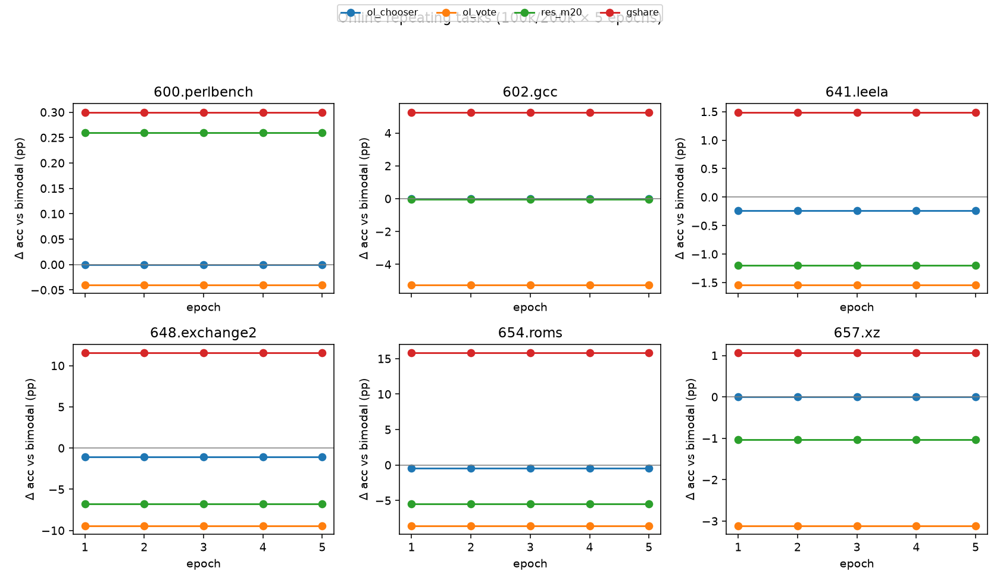
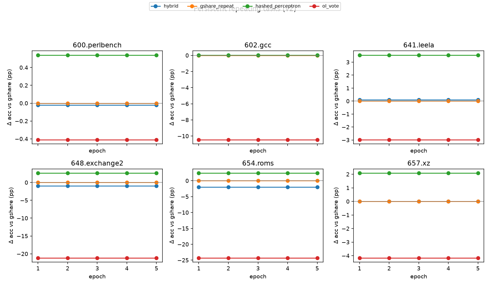
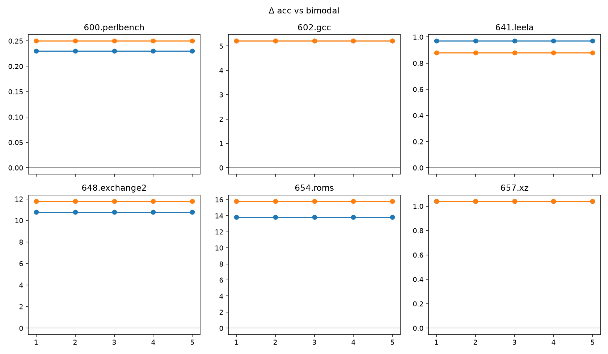

# Adaptive Neural Branch Assistance (ANBA) — findings

**Repo:** [cpu-branch-prediction-research](https://github.com/abhijayhm/cpu-branch-prediction-research)  
**Scope:** ChampSim side-study on SPEC CPU2017 traces (mostly warmup 100k / sim 200k–500k).  
**Rule:** Tables use **measured** simulator output only (`fabricated: false` in `results/parsed/*`).

---

## Executive summary

We asked whether a **tiny neural assistant** can help **only where a classic predictor is uncertain**, with offline-trained INT8 MLPs, a residual specialist, a mini causal transformer (NN-T), and later an **online corrector on top of gshare**.

| Claim | Result |
|---|---|
| Beat **bimodal** on hard held-out code with a **gated** residual MLP or NN-T | **Tie** (0.00 pp, 0 IPC) — safe |
| Ungated hybrid on uncertain branches | **Large loss** (~−5 to −7 pp vs bimodal) |
| Generalize frozen specialists to **unseen** programs | **Mostly fails** unless margin is so high the gate never overrides |
| **Online** learning on **repeating** traces | Flat curves after epoch 1; **gshare** and **hashed_perceptron** dominate **bimodal** |
| Our best vs **gshare** (online v2, held-out) | **+0.09 pp** on `641.leela` only; **no IPC win** anywhere |
| vs **hashed_perceptron** (same v2 matrix) | **hashed_perceptron beats our hybrids** by **+0.04 to +3.55 pp** on every test trace |

**Bimodal was too weak** as the primary comparison for “did we beat a real CPU-style predictor.” Against **gshare** and **hashed_perceptron**, our gated offline nets **tie or lose**; the only measured win over gshare is **+0.09 pp** on leela.

**Plausible next step (not built here):** an online corrector on **hashed_perceptron** misses (same gshare-hybrid pattern). Expect **tenths of a pp** at best if anything — speculative, not measured.

---

## Architecture (all phases)

```text
branch → classic base (bimodal, later gshare / hashed_perceptron)
           ├─ confident (2-bit saturated) → classic
           └─ uncertain → tiny NN (only if |logit| ≥ margin) → else classic
```

Training labels are **true `taken`**, not the classic prediction. Specialists emphasize **classic mispredictions** in the residual curriculum.

---

## Phase 1 — NN-A / NN-B / NN-C and residual gate

**Models:** 32-feature ±1 vectors (16 PC bits + 16-bit GHR); NN-A (16 hidden), NN-B (32→8), NN-C perceptron; INT8 export to C++.

**Hard held-out test** (`654.roms`, `648.exchange2`; warmup 100k / sim 200k; split `spec_residual_v1`):

| Workload | Bimodal acc / IPC | Ungated `anba_hybrid` | **Residual + gate (m=8)** |
|---|---:|---:|---:|
| roms | 80.48% / 1.507 | 75.58% / 1.367 | **80.48% / 1.507** |
| exchange2 | 84.04% / 1.676 | 76.65% / 1.453 | **84.04% / 1.676** |


Roughly **16–20%** of branches sit in the uncertain pool on these traces; instrumented dumps show ~**12%** `predicted ≠ taken` disagreement rate (failover opportunity, not captured IPC upside).


**Lesson:** Confidence **gating** turns a harmful ungated hybrid into a **bimodal tie**. No measured IPC gain on hard tests.

Artifact: `results/parsed/residual_matrix_summary.json`.

---

## Phase 2 — Mini transformer (NN-T)

**NN-T:** 2-layer causal transformer (seq_len=64, d_model=48, 4 heads) over tokenized branch history (11-bit PC hash + taken; current branch = PC-only token). Same **residual curriculum** as the MLP specialist; val margin tuned on `631.deepsjeng` only.

**Offline val** (`train_residual_nn_t.json`): val accuracy **59.7%**; gated val replay **89.5%**; tuned logit margin **8.0** (override rate **39.4%**, precision **57.9%** on uncertain val branches).

**C++ parity bug and fix:** Early ChampSim NN-T logits did not match PyTorch export (token assembly / causal attention / bimodal table replay). We added **`tools/parity_transformer.py`** + **`tools/cpp_transformer_logit`** and fixed **bimodal counter replay** (saturated counter init consistent with ChampSim `fwcounter`). After parity, **margin was re-tuned to 20** for val-safe behavior; margin **8** on test causes harmful overrides (see unseen-programs gcc).

**Held-out hard test** (100k/200k; `transformer_matrix_summary.json`):

| Trace | Bimodal | Residual+gate | **NN-T+gate (m=20)** | Δ acc / IPC vs bimodal |
|---|---:|---:|---:|---:|
| `654.roms` | 80.48% / 1.507 | 80.48% / 1.507 | **80.48% / 1.507** | **0 / 0** |
| `648.exchange2` | 84.04% / 1.676 | 84.04% / 1.676 | **84.04% / 1.676** | **0 / 0** |


**Timing:** `anba_transformer_hybrid` ≈ **12 s**/trace (100k/200k roms). `nn_transformer_frozen` full window **>4 min** (aborted); 10k/20k smoke only.

**Lesson:** NN-T + gate **matches** residual MLP + gate on hard test — **ties bimodal**, **no IPC win**.

---

## Phase 3 — Unseen programs

**Setup:** Frozen residual MLP and NN-T (no retrain). Eight SPEC candidates screened with **bimodal** (50k/50k); **four lowest** bimodal accuracies run at 100k/200k. Gate telemetry via `ANBA_GATE_STATS`.

**Screening (bimodal acc %):** leela 85.03, gcc 94.62, xz 96.81, perlbench 98.13 (selected); xalancbmk/mcf/x264 higher; omnetpp trace missing.

**Δ acc vs bimodal (pp)** on full matrix:

| Trace | Residual m8 | Residual m20 | NN-T m8 | **NN-T m20** |
|---|---:|---:|---:|---:|
| `641.leela` | −1.24 | −1.20 | −0.26 | **0.00** |
| `602.gcc` | −0.02 | −0.02 | **−5.23** | **0.00** |
| `657.xz` | −1.03 | −1.03 | 0.00 | **0.00** |
| `600.perlbench` | +0.26 | +0.26 | +0.07 | **0.00** |

**Lesson:** **Margin-20** NN-T + gate **ties bimodal** everywhere (zero overrides). **Margin-8** NN-T **destroys gcc** (~5 pp, override precision ≈1%). Frozen residual **overrides aggressively** on unseen code and **loses** on leela/xz despite high precision on gcc. **No IPC win.**

Artifact: `results/parsed/unseen_programs_matrix_summary.json`.

---

## Phase 4 — Online repeating tasks

### v1 (reset bimodal each epoch)

K=5 replays, 100k/200k, cold 32-feat perceptron on **bimodal misses**, chooser vs **vote** aggregate. Compared to bimodal, residual m20, **gshare** (reset each run).



**Δ acc vs bimodal (epoch 1 ≈ epoch 5):**

| Trace | gshare | Residual m20 | Chooser | Vote (pre-fix) |
|---|---:|---:|---:|---:|
| `641.leela` | +1.49 | −1.20 | −0.24 | −1.54 |
| `602.gcc` | +5.27 | −0.02 | +0.01 | −5.25 |
| `657.xz` | +0.26 | −1.03 | 0.00 | −1.03 |
| `600.perlbench` | +0.30 | +0.26 | 0.00 | −0.04 |
| `654.roms` | +8.55 | −5.48 | −0.41 | −8.55 |
| `648.exchange2` | +11.54 | −6.75 | −1.09 | −9.41 |

Flat curves: deterministic replay + bimodal reset; online weights saturate in epoch 1.

Artifact: `results/parsed/online_repeating_summary.json`.

### Vote mirror bug

`anba_online_repeat_vote` **gated** on `combined = bim_vote·4 + macc/2` but returned **`model_pred = (macc ≥ 0)`**. When C++ `macc/2` (truncate toward zero) disagrees with the combined sign, overrides invert the intended vote. Metric symptom: **Δ vs gshare ≈ 2·(Δ bimodal vs gshare)** (gcc vote **−10.46 pp** vs gshare with bimodal **−5.21 pp**). **Fixed:** `last_pred = vote_taken`. Test: `tests/test_online_vote_aggregate.py`. **Vote remains harmful** after fix (~99% override rate, &lt;1% precision on gcc).

### v2 (persistent gshare + hybrid corrector)

K=5, **100k/500k**, **persistent** `gshare_repeat` + `anba_gshare_online` (64-feat perceptron on **gshare misses**, chooser + hysteresis). Hyperparams swept on **val** (`631.deepsjeng`, epochs 1–2) only. Baselines: bimodal, **gshare_repeat**, **hashed_perceptron**, chooser, vote (fixed).





**Δ branch accuracy vs gshare (pp), final epoch:**

| Trace | hashed_perceptron | **gshare-hybrid** | chooser | vote (fixed) |
|---|---:|---:|---:|---:|
| `641.leela` | +3.55 | **+0.09** | −1.07 | −2.98 |
| `602.gcc` | +0.04 | **0.00** | −5.21 | −10.46 |
| `657.xz` | +2.08 | 0.00 | −1.04 | −4.16 |
| `600.perlbench` | +0.54 | −0.02 | −0.26 | −0.41 |
| `654.roms` | +2.37 | −1.98 | −16.29 | −24.28 |
| `648.exchange2` | +2.61 | −1.00 | −12.26 | −21.14 |

**IPC:** hybrid vs gshare within **≤0.002** on all traces — **no IPC win**.

**Only win vs gshare:** `641.leela` **+0.09 pp** (IPC **1.20**, tied). Val tune best: **+0.19 pp** on deepsjeng epoch 2.

Artifacts: `results/parsed/online_repeating_v2_summary.json`, `online_tune_val.json`.

---

## What we are not claiming

- Beating industrial **TAGE** / tournament predictors  
- Product **IPC** improvements (none measured)  
- That **bimodal** alone is a strong baseline (it is not — **gshare** and **hashed_perceptron** are)  
- Guaranteed gains from a future **hashed_perceptron + online corrector** (reasonable hypothesis, **not run**)

---

## Reproducibility

```bash
make traces champsim
make residual-matrix          # Phase 1 residual gate
bash experiments/transformer_matrix.sh   # Phase 2 NN-T hard test
bash experiments/unseen_programs_matrix.sh
bash experiments/online_repeating_matrix.sh   # v1
bash experiments/online_repeating_v2.sh       # v2 + val tune
python3 -m unittest tests/test_online_vote_aggregate.py
```

Charts: `python3 tools/make_transformer_chart.py`, `tools/make_online_repeating_charts_v2.py`, etc. (see `experiments/`).

---

## Closing

The durable result is **methodological**: **confidence gating** and **strong classic baselines** matter more than architecture (MLP vs transformer). Measured wins over **gshare** are **+0.09 pp** on one trace; **hashed_perceptron** beats our hybrids everywhere in the v2 matrix. A serious corrector should sit on **hashed_perceptron**, not bimodal — expect **small** accuracy deltas if it works at all.
