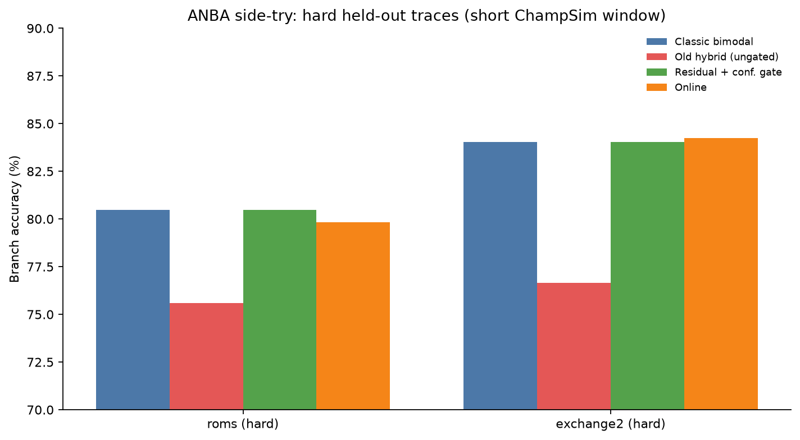
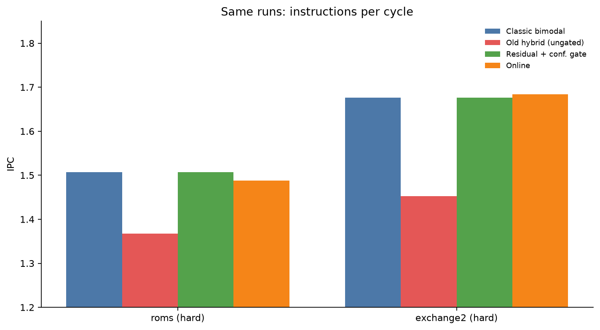
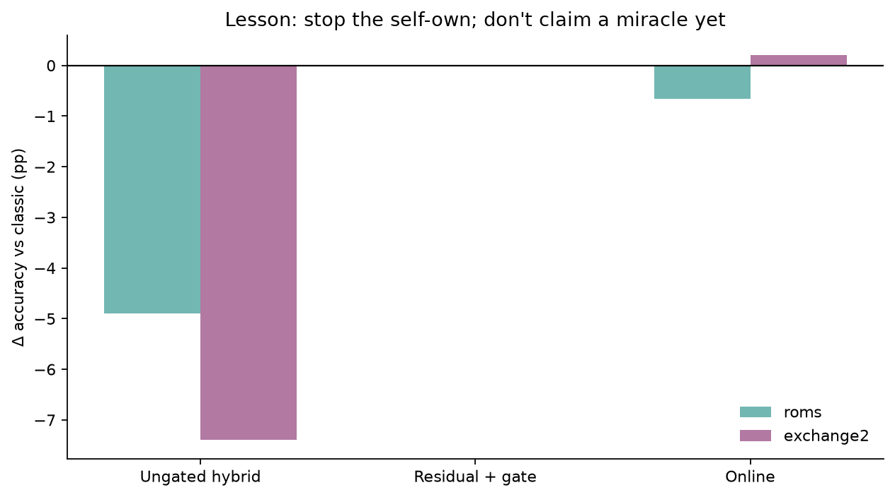
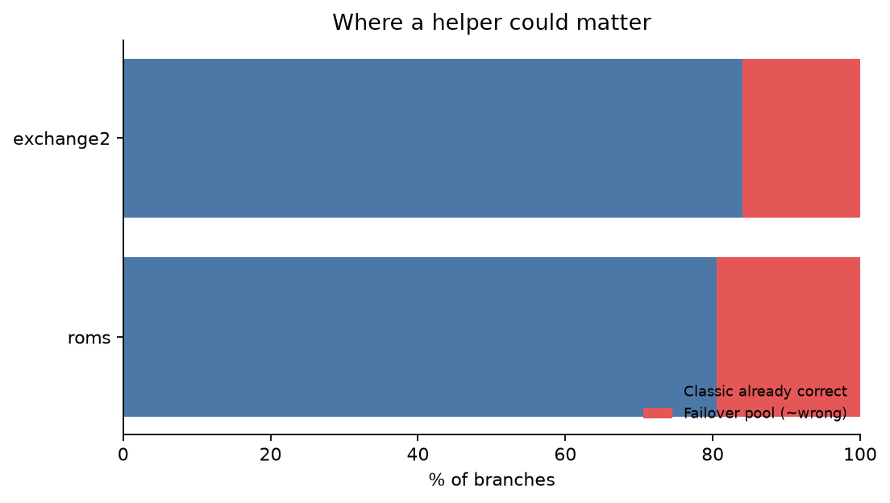
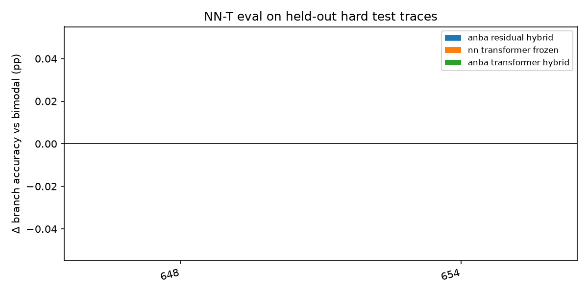

# Adaptive Neural Branch Assistance (ANBA)

### A short ChampSim side-try: tiny neural failover for uncertain branches  
**Status:** fun research incident / workshop-style note — not a claim that we beat modern CPUs  
**Repo:** https://github.com/abhijayhm/cpu-branch-prediction-research  
**Author framing:** built with heavy Cursor cloud-agent help + Grok Bot coordination, minimal babysitting

---

## Abstract

We explore **Adaptive Neural Branch Assistance (ANBA)**: keep a classic branch predictor for easy branches, and consult a *tiny* neural net only when the classic predictor is uncertain (and, in the safer design, only when the net is confident).

In short ChampSim experiments on public SPEC CPU2017 traces:

- Letting the net override whenever the classic predictor hesitates **hurts** accuracy on hard held-out workloads (about **−5 to −7 percentage points** vs bimodal).
- Training with emphasis on classic mistakes + a **confidence gate** stops that self-own: we **match** classic bimodal on those same hard short runs (**~0 pp** delta).
- We do **not** claim a stable IPC win over strong heuristics yet. A chaseable future (on-device / NPU residual + runtime adaptation) is framed as **hopeful but unoptimistic**: maybe **~1–3% IPC** if things go well — not a branch-prediction rewrite.

All tables below are from real simulator runs (`fabricated: false` in repo JSON artifacts).

---

## 1. Why bother (the fun hypothesis)

Modern CPUs already have excellent predictors. The interesting question is not “can an NN classify branches?” but:

> Can a **small** neural assistant help **specifically where a conventional predictor is uncertain**, especially with later on-device adaptation?

ANBA treats the NN as a **failover supporter**, not a replacement.

```text
branch → classic predictor
            ├─ confident  → use classic
            └─ uncertain  → tiny NN (only if confident) → else classic
                 └─ optional online / future NPU adapt
```

---

## 2. What we built (2-hour-ish research incident energy)

End-to-end in this repo:

- ChampSim pin + baseline **bimodal**
- Trace download (Zenodo SPEC2017 ChampSim traces)
- Trace-level train/val/test splits (no leakage)
- Tiny nets **NN-A / NN-B / NN-C**, INT8 export into C++ predictors
- Modes: frozen NN, ungated hybrid, online, **residual hybrid**
- Acceptance harness + hard-workload matrices

**Labels:** training uses true branch outcomes (`taken`), never the classic predictor’s guess as the target. Classic mistakes are already “corrected” in the label because the label is reality.

---

## 3. Measured results (the honest ones)

### 3.1 Hard held-out short window (warmup 100k / sim 200k)

Branch accuracy (%):

| Workload | Classic bimodal | Ungated hybrid | Residual + gate | Online |
|---|---:|---:|---:|---:|
| `654.roms` | **80.5** | 75.6 | **80.5** | 79.8 |
| `648.exchange2` | **84.0** | 76.7 | **84.0** | 84.3 |

IPC:

| Workload | Classic | Ungated hybrid | Residual + gate | Online |
|---|---:|---:|---:|---:|
| roms | **1.51** | 1.37 | **1.51** | 1.49 |
| exchange2 | **1.68** | 1.45 | **1.68** | 1.68 |

**Punchline:** residual + confidence gate **ties** classic; ungated hybrid **loses**.







### 3.2 Where a helper could matter

On these hard traces, classic is wrong on roughly **~16–20%** of branches (the failover pool). Instrumented dumps showed ~**12%** disagreements (`predicted != taken`).



### 3.3 A friendlier smoke hint (not the hard-test claim)

On an easier short window (`649.fotonik3d`), **online** once showed roughly **~+5% IPC** vs bimodal. We treat that as a *hint*, not the headline for hard held-out evaluation.

---

## 4. What we are *not* claiming

- Not beating TAGE-class industrial predictors  
- Not a measured NPU result  
- Not a guaranteed multi‑percent product win  
- Not “the dataset was flipped wrong” — we audited labels; they’re true outcomes  

---

## 5. Chaseable future (hopeful, unoptimistic)

If a dedicated low-latency unit (e.g. tiny NPU path) handled **only worse/uncertain branches** with **runtime adaptation**:

| Stance | Estimate |
|---|---|
| **Measured now** | **~0%** boost on hard short tests (tie) |
| **Stable-ish chase target** | **~1–3% IPC** if adaptation + latency cooperate |
| **Hype** | 5%+ — possible in a dream, **not** something to stand behind yet |

This is **scenario analysis**, not a corrected experimental table.

---

## 6. Reproducibility

```bash
make accept
make hard-domain-matrix   # prior hard eval
make residual-train
make residual-matrix      # residual specialist eval
```

Artifacts: `results/parsed/*_summary.json` (`fabricated: false`).

---

## 7. Closing

This note is a **side-try**: a small neural failover idea, stress-tested quickly with ChampSim, Cursor cloud agents, and a coordinating assistant. The scientific win so far is methodological — **gating beats vibes**. The product win is still a chase.

---

## Mini transformer try

**NN-T:** 2-layer causal transformer (seq_len=64, d_model=48, 4 heads) over tokenized recent branches (11-bit PC hash + taken; current branch uses PC-only token). Trained on the **same residual curriculum** as the MLP specialist (ordered instrumented traces; labels = true `taken`; val margin tuned only on `631.deepsjeng`).

**Offline val (not test):** val row accuracy **59.7%**; gated val replay accuracy **89.5%**; tuned logit margin **8.0** (override rate **39.4%**, precision **57.9%** on uncertain val branches). Artifact: `results/parsed/train_residual_nn_t.json`.

**Held-out hard test (warmup 100k / sim 200k):**

| Trace | Bimodal | Residual + gate | NN-T + gate | Δ acc vs bimodal (NN-T+gate) | Δ IPC |
|---|---:|---:|---:|---:|---:|
| `654.roms` | 80.48% / 1.507 | 80.48% / 1.507 | 80.48% / 1.507 | 0.00 pp | 0.000 |
| `648.exchange2` | 84.04% / 1.676 | 84.04% / 1.676 | 84.04% / 1.676 | 0.00 pp | 0.000 |

**NN-T frozen alone** at full windows was **not** completed in reasonable time (≈4+ min/trace vs ≈12 s for gated hybrid on roms); smoke runs use smaller windows and are **not** in the table above.



**Honest read:** NN-T + gate **matches** bimodal on these hard held-out shorts — same as the residual MLP + gate. No measured IPC gain; no claim that the transformer beats the tiny MLP specialist on test.

---

## Unseen programs

**Setup:** Frozen residual MLP and NN-T exports (no retrain). Workloads **outside** ANBA residual / hard-domain train·val·test (and outside easy-only `spec_hard_v1` train). Eight SPEC2017 candidates were screened with **bimodal only** (warmup 50k / sim 50k); we kept the **four lowest bimodal accuracies** for the full matrix (warmup 100k / sim 200k). `620.omnetpp` was unavailable during screening (Zenodo timeout). Gate telemetry (`ANBA_GATE_STATS`) is now emitted for **residual** hybrid as well as NN-T.

**Bimodal screening (50k/50k):**

| Trace | Bimodal acc % | MPKI | Selected |
|---|---:|---:|:---:|
| `641.leela_s-334B` | 85.03 | 24.92 | yes |
| `602.gcc_s-734B` | 94.62 | 12.66 | yes |
| `657.xz_s-56B` | 96.81 | 0.64 | yes |
| `600.perlbench_s-1273B` | 98.13 | 2.54 | yes |
| `623.xalancbmk_s-592B` | 98.92 | 3.98 | no |
| `625.x264_s-20B` | 99.72 | 0.06 | no |
| `605.mcf_s-1554B` | 100.00 | 0.00 | no |
| `620.omnetpp_s-874B` | — | — | missing trace |

**Full comparison vs bimodal (100k/200k):** acc % / IPC; Δ acc in pp; override rate / precision on uncertain branches.

| Trace | Bimodal | Residual m8 | Residual m20 | NN-T m8 | NN-T m20 |
|---|---|---|---|---|---|
| `641.leela` | 87.21 / 1.147 | 85.97 (−1.24) / 1.110 · ov 94% / prec 49% | 86.01 (−1.20) / 1.110 · ov 90% / prec 48% | 86.95 (−0.26) / 1.139 · ov 43% / prec 61% | **87.21 / 1.147** · ov 0% |
| `602.gcc` | 94.69 / 0.496 | 94.67 (−0.02) / 0.496 · ov 100% / prec 98% | same Δ · ov 100% / prec 98% | 89.46 (−5.23) / 0.429 · ov 98% / prec **0.9%** | **94.69 / 0.496** · ov 0% |
| `657.xz` | 96.87 / 2.112 | 95.84 (−1.03) / 2.112 · ov 100% / prec 67% | same Δ · ov 99% / prec 67% | 96.87 (0.00) / 2.112 · ov 33% / prec 100% | **96.87 / 2.112** · ov 0% |
| `600.perlbench` | 97.83 / 2.052 | 98.09 (+0.26) / 2.056 · ov 50% / prec 71% | same Δ · ov 49% / prec 71% | 97.90 (+0.07) / 2.054 · ov 16% / prec 95% | **97.83 / 2.052** · ov 0% |

Artifact: `results/parsed/unseen_programs_matrix_summary.json` (`fabricated: false`).

**Honest read:** On genuinely unseen code, **margin-20 NN-T + gate ties bimodal** everywhere (zero overrides — same safe behavior as hard held-out test). **Margin-8 NN-T** can help slightly on leela/perlbench but **catastrophically hurts gcc** (≈5 pp, override precision ≈1%). The **residual MLP** overrides aggressively on unseen traces (often >90% of uncertain branches) and **loses** on leela/xz despite high override precision on gcc; it is **not** a safe generalizer without retraining. No consistent IPC win.

